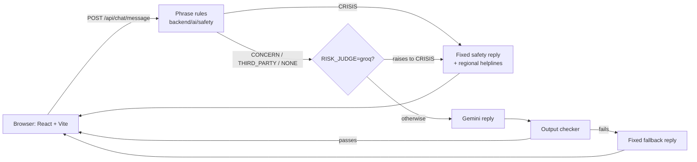

# Aura

A mental-wellness chat companion whose crisis routing is measured, not assumed: a message
that may signal suicide risk gets a fixed, reviewed reply with the right helpline, never
an LLM-generated one.

[](https://github.com/CODER7657/genex-prj/actions/workflows/ci-cd.yml)
[](LICENSE)

**Live:** not hosted; it runs locally in two commands (below). The backend needs a
database and model key, so there is no public instance. This is safety-evaluation work on synthetic messages, **not a clinical tool**.

## Measured results

Crisis routing on held-out messages the system was never tuned on (v2 sealed and scored 2026-10-21; synthetic,
written and committed before any run). Full method, per-case results and every miss:
[`docs/SAFETY_EVAL.md`](docs/SAFETY_EVAL.md).

| Sealed held-out set v2 (74 cases) | Phrase rules only | **Rules + LLM risk judge** |
|---|---|---|
| Crisis messages routed to the safety reply | 3/35 (9%) | **26/35 (74%)** |
| Crisis messages given at least a helpline | 3/35 (9%) | **28/35 (80%)** |
| Distress messages given support | 2/11 | **11/11** |
| Someone-else-at-risk answered as such | 0/8 | **5/8** |
| Harmless messages treated as a crisis | 3/20 (15%) | 3/20 (15%) |

| Other checks | Result |
|---|---|
| Main set (107 cases, used to build the rules) | 49/49 crisis routed, 0/36 false alarms |
| Held-out v1 (41 cases), rules only | 3/20 crisis routed, 0/11 false alarms |
| Red team (30 adversarial prompts): attacks that got through | 2/30 model alone, **1/30** full pipeline |
| Embedding classifier (multilingual-e5-small) on v2, as a comparison | 14/35 alone, 16/35 with rules |

Reproduce the rule-based numbers (no network):

```bash
cd backend
node scripts/safety-eval.js              # main set, every miss listed
node scripts/safety-eval.js --holdout    # held-out v1
```

The judge numbers come from `node scripts/judge-eval.js --set holdout2` (needs a Groq
key); its raw outputs are committed in [`docs/eval/judge_results.json`](docs/eval/judge_results.json).

## How it works



Every message is routed **CRISIS**, **THIRD_PARTY** (worried about someone else),
**CONCERN** or **NONE** by phrase rules in [`backend/ai/safety/`](backend/ai/safety). A
CRISIS route always gets a fixed, reviewed reply, so a crisis never depends on the LLM
being up or on how it would phrase things. With `RISK_JUDGE=groq`, a Groq-hosted safety
classifier (`openai/gpt-oss-safeguard-20b`) reads every message the rules did not route
CRISIS and may raise it, never lower it. Every Gemini reply passes an output checker
(method details, discouraging help, claiming to be a professional) before it is shown.
Helplines follow `CRISIS_REGION` (India: Tele-MANAS 14416 and 112; US: 988 and 911; UK);
with no region set the reply lists India, the US and findahelpline.com.

Around the chat: mood check-ins and trends, goals and reminders, wellness resources,
voice input and read-aloud (the browser's Web Speech API), in a soft Clay-style light design. The API
is Express on Node, with SQLite in development and Postgres via `DATABASE_URL` in
production.

## Run it locally

Needs Node 22+.

```bash
# API on :5000
cd backend
npm ci
cp ../.env.example .env        # set GEMINI_API_KEY; JWT_SECRET and SESSION_SECRET to long random strings
npm run dev

# Web app on :5173 (in a second terminal)
cd frontend
npm ci
npm run dev                    # calls http://localhost:5000/api unless VITE_API_URL is set
```

Optional: `CRISIS_REGION=IN|US|UK`, and `RISK_JUDGE=groq` with `GROQ_API_KEY` to turn on
the LLM risk judge. Keys live only in the git-ignored `.env`.

## Test it

```bash
cd backend
npx jest           # 288 tests, no network: routing guarantees, crisis gate, helplines
npm run lint

cd ../frontend
npm test           # crisis screen and helpline lists
npm run test:e2e   # Playwright + axe at 375, 768 and 1280 px
```

`backend/test/safety.test.js` pins what the rebuild guarantees: every message routed
CRISIS gets the fixed reply; no case either older detector handled is lost; no harmless
message in either evaluation set is treated as a crisis; helplines match the region; a
past suicide attempt is never softened to concern by "years ago". CI runs these on every
pull request, with a dependency and container scan.

## Limitations

- **Recognition is the weak point.** The phrase rules catch the phrasings they were
  written for: 15% of held-out v1 crisis messages and 9% of v2. The LLM judge raises v2
  to 74%, which still means about 1 in 4 crisis messages gets an ordinary reply.
- **The judge is off by default** and needs a Groq key; it adds a network call to every
  message the rules do not route CRISIS. If it fails or times out, the rules' route stands.
- **The judge raises false alarms** the rules already make (3/20 harmless messages on v2
  treated as a crisis), and some of its errors are listed in `docs/SAFETY_EVAL.md`.
- **All evaluation messages are synthetic**, mostly English with some Hinglish. Nothing here is validated on real users or by clinicians.
- **Not a therapist and not an emergency service.** In an emergency call your local
  emergency number.

## Licence

MIT, see [`LICENSE`](LICENSE). The evaluation sets in `backend/ai/safety/` and
`docs/eval/` are original synthetic messages under the same licence.
